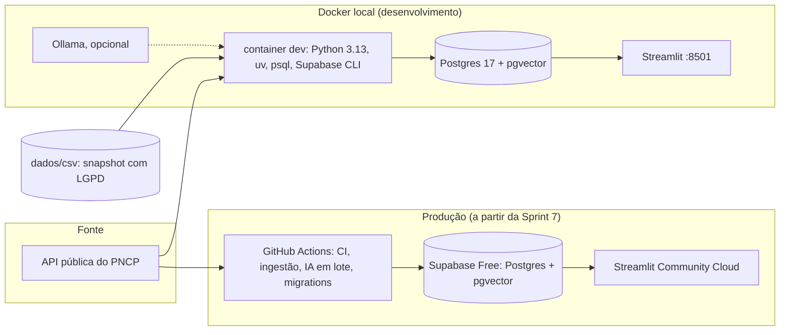
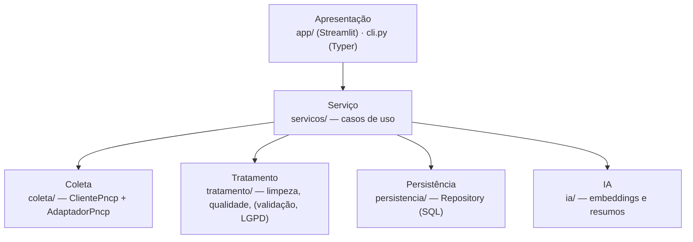
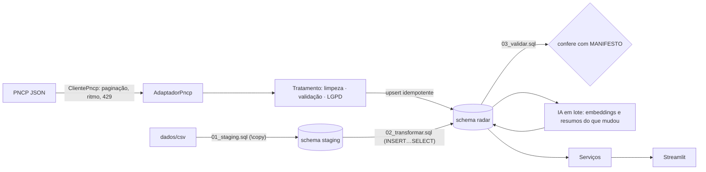
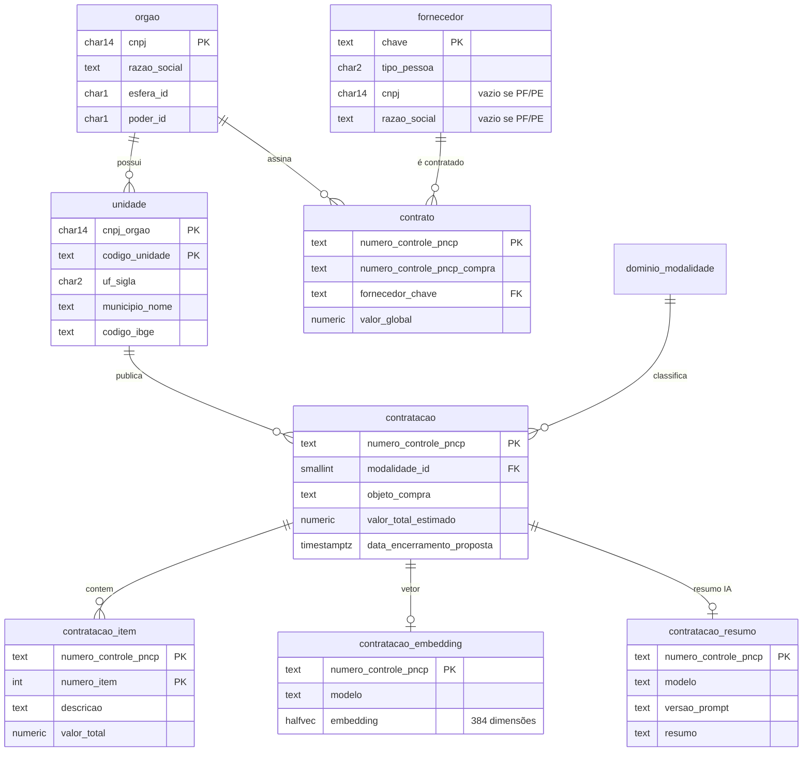

# Arquitetura do Radar de Licitações

Este documento explica **como o sistema é organizado e por quê**. As decisões importantes têm um
registro próprio em [`docs/adr/`](adr/README.md).

## 1. Visão geral

O mesmo código roda nos dois mundos. O que muda é a variável `DATABASE_URL`: no Docker aponta
para o container `db`, em produção para o pooler do Supabase.

## 2. Camadas

Regra: **cada camada só conhece a de baixo.** O Streamlit não monta SQL; o Repository não sabe que
existe Streamlit; o Adapter é o único que conhece o JSON do PNCP.

| Camada | Pasta | Padrão | Por que este padrão |
|---|---|---|---|
| Coleta | `coleta/` | **Adapter** | A API tem nomes próprios (`orgaoEntidade`, `unidadeOrgao`...) e muda. Isolar a tradução JSON → domínio deixa o resto do sistema estável. |
| Tratamento | `tratamento/` | Funções puras | Entrada e saída, sem banco e sem rede: fáceis de testar e de explicar. |
| Persistência | `persistencia/` | **Repository** | Os serviços dependem de um contrato (`RepositorioLicitacoes`), não do Postgres. Nos testes entra o `RepositorioMemoria`. |
| IA | `ia/` | **Strategy + Factory** | Modelos e limites gratuitos mudam. Trocar de provedor vira configuração (`RADAR_EMBEDDINGS`, `RADAR_RESUMO`). |
| Serviço | `servicos/` | **Service layer** | Um caso de uso ("listar abertas", "coletar") é escrito uma vez e usado pela CLI, pelo app e pelo pipeline. |
| Apresentação | `app/`, `cli.py` | — | Streamlit: Python do começo ao fim, sem front-end separado. |

## 3. Fluxo de dados

Duas portas de entrada para o mesmo banco:
1. **Carga CSV** (Sprint 0): o snapshot real em `dados/csv` passa por `staging` (tudo texto) e chega ao
   `radar` com tipos, fuso e chaves. É assim que se carrega dado bruto com segurança: primeiro pousa,
   depois transforma.
2. **Ingestão pela API** (fase 2): o pipeline coleta, trata e faz *upsert* direto no `radar`.

## 4. Modelo de dados

Decisões de modelagem que merecem atenção:
- **Domínios em tabelas próprias** (`dominio_*`): chave estrangeira de verdade. O banco recusa um código
  inexistente.
- **`contrato.numero_controle_pncp_compra` sem FK:** a compra de origem pode estar fora do recorte.
  É uma referência lógica, escolhida de propósito.
- **LGPD no banco:** `fornecedor_lgpd_pf_sem_identificacao` impede gravar documento ou nome de PF/PE,
  mesmo que o código tenha bug.
- **IA em tabelas separadas, com `modelo` e `versao_prompt`:** trocar de modelo não apaga o histórico.
- **`halfvec(384)`:** metade do espaço de `vector`, para caber nos 500 MB do Supabase gratuito.
- **Datas como `timestamptz`:** o PNCP manda horário de Brasília sem fuso; a carga converte.
- **Papéis `radar_leitura` e `radar_escrita`:** o app só lê; o pipeline escreve.

## 5. Ambientes

| | Desenvolvimento | CI (GitHub Actions) | Produção (Sprint 7+) |
|---|---|---|---|
| Banco | container `db` (pgvector 0.8.7, PG 17) | service container igual ao local | Supabase Free (PG 17, pgvector), via pooler IPv4 |
| Migrations | `bash banco/migrar.sh` | `bash banco/migrar.sh` | workflow `deploy-banco.yml` |
| Carga inicial | `banco/carga/*.sql` | `bash banco/carregar.sh` | mesmos scripts, outra `DATABASE_URL` |
| App | `docker compose up` → :8501 | — | Streamlit Community Cloud |

## 6. Quirks da API do PNCP (viram tarefas, não segredos)

| Quirk | Como lidamos |
|---|---|
| **HTTP 429** depois de ~20 chamadas por minuto na API de consultas (medido em 15/10/2026) | intervalo fixo hoje; backoff + `Retry-After` + ritmo adaptativo na Sprint 4 |
| `dataFinal` em `/contratacoes/proposta` é o teto do **encerramento das propostas** | documentado no cliente; 365 dias = "todas abertas" |
| `/contratos` **não tem filtro de UF**; a data filtra a **publicação**, não a assinatura | filtro no cliente; validação de resultados na Sprint 5 |
| `codigoModalidadeContratacao` é obrigatório em `/contratacoes/publicacao` | o cliente itera modalidades quando precisar |
| Itens: sem `tamanhoPagina`, a API devolve **só 10** | sempre `tamanhoPagina=500` + paginação |
| Fornecedor PF vem com **CPF** e nome; textos citam pacientes e processos judiciais | LGPD aplicada antes de gravar (Sprint 6 no pipeline) |
| Filtros podem ser ignorados sem aviso | validar cada registro contra o filtro pedido (Sprint 5) |

## 7. Limites gratuitos considerados (verificados em 15/10/2026)

| Serviço | Limite que afeta o projeto | Como respeitamos |
|---|---|---|
| Supabase Free | 500 MB de banco (acima disso fica só leitura); 2 projetos ativos por conta admin; pausa após 7 dias com pouca atividade; sem backup | recorte por UF, `halfvec`, medição de tamanho (Sprint 14), ping semanal com escrita |
| GitHub Free (org) | proteção de branch e rulesets só em repositório **público**; Actions ilimitado em público; agendamentos desligam após 60 dias sem atividade | repositórios públicos; documentado |
| Streamlit Community Cloud | 690 MB–2,7 GB de RAM; app dorme após 12 h sem acesso; pode construir em Python 3.14 | dependências leves; CI também em 3.14 |
| Hugging Face | contas gratuitas **não têm** mais crédito de inferência; Spaces Gradio/Docker exigem plano pago | embeddings locais (FastEmbed) e LLM local (Ollama) |
